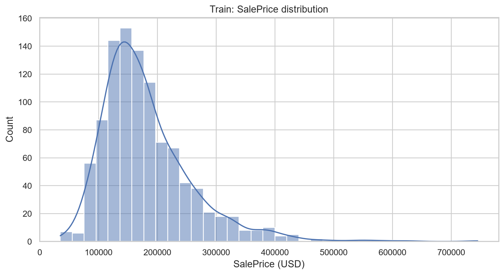
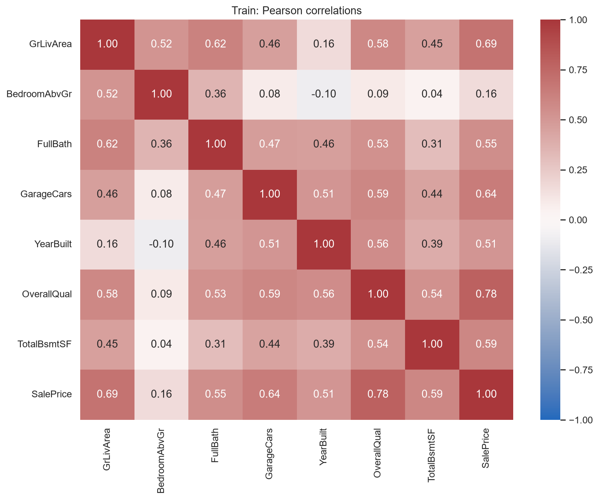
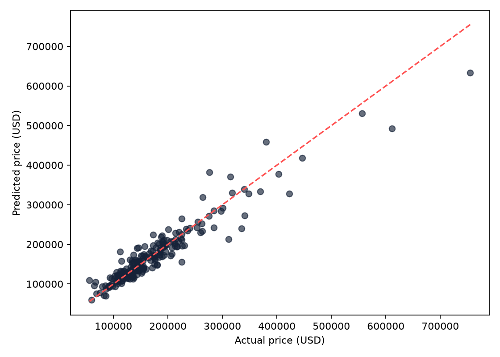
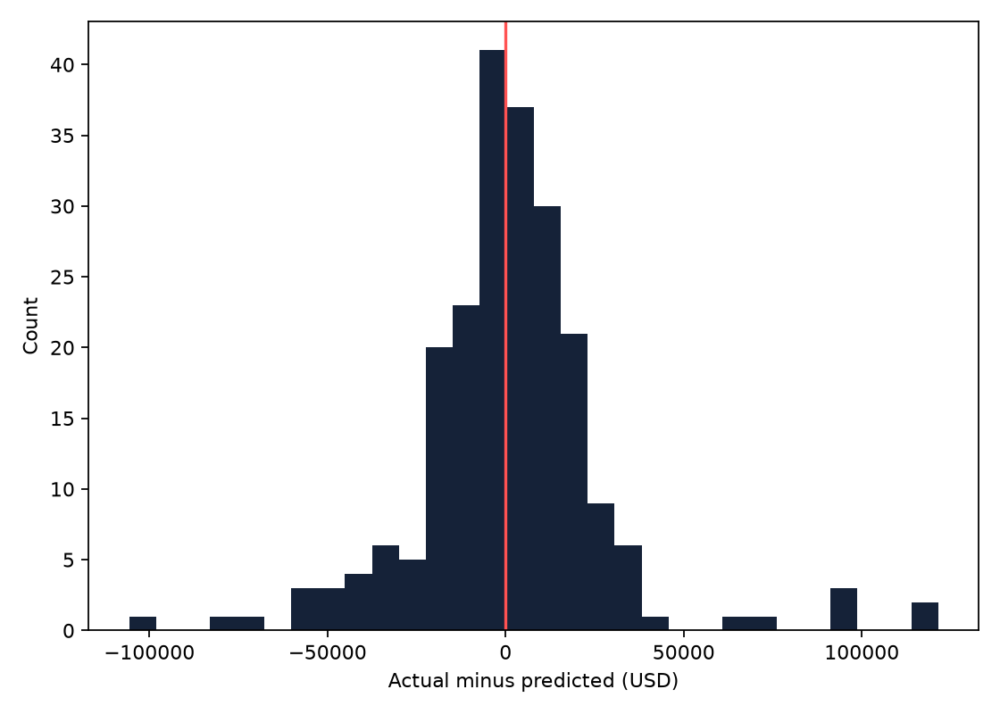
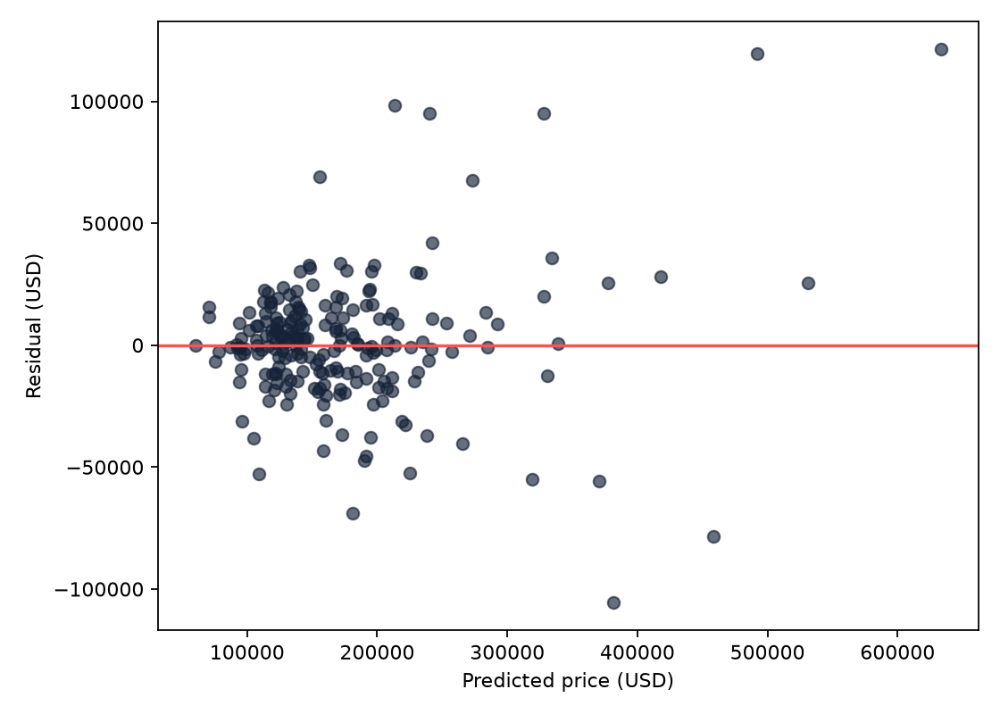
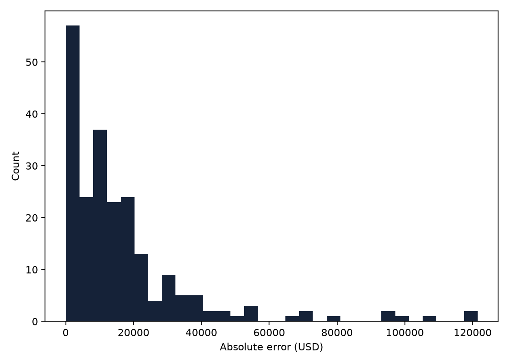
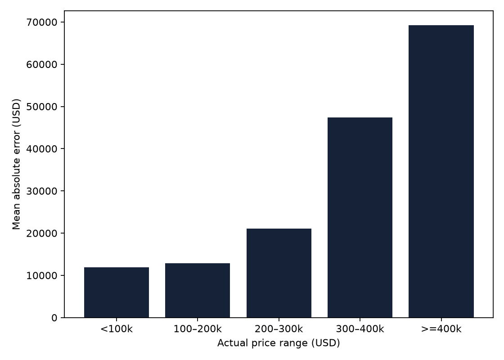
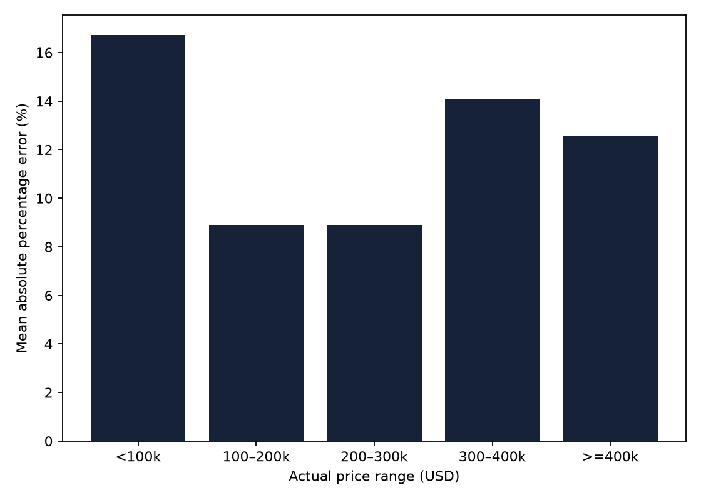
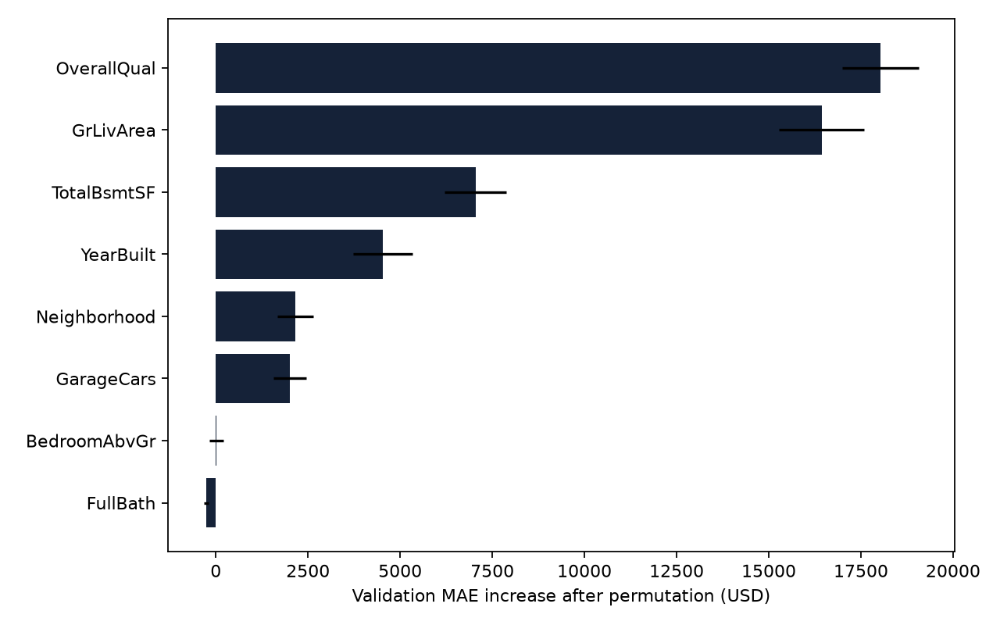

# HOUSEPRICE AI — Báo cáo đồ án cuối kỳ

Ngày lập: 2026-10-19T13:32:25.680014+07:00. Trạng thái dự án: **READY**; GPU: **GPU READY**.

## Chương 1 – Tổng quan đề tài

### 1.1. Lý do và mục tiêu

Giá bất động sản phụ thuộc đồng thời vào vị trí, quy mô, chất lượng và thời điểm xây dựng. Hồi quy bằng cây tăng cường cho phép mô hình hóa tương tác phi tuyến giữa các yếu tố này. Đề tài xây dựng một quy trình có thể kiểm chứng: kiểm tra dữ liệu, phân chia độc lập, tiền xử lý đúng phạm vi, lựa chọn mô hình bằng Validation và đánh giá cuối trên Test đã giữ riêng. Mục tiêu ứng dụng là website giúp người học khám phá dữ liệu và thực hiện dự đoán thật.

### 1.2. Phạm vi và công nghệ

Nghiên cứu giới hạn ở dữ liệu Ames/Kaggle lịch sử, tám thuộc tính đã xác định từ giai đoạn trước, target SalePrice bằng USD. Đây không phải hệ thống định giá giao dịch hiện tại hoặc định giá nhà tại Việt Nam. Hệ thống kế thừa đầy đủ Tuần 1–3 và UI refactor. Công nghệ gồm Python, pandas, NumPy, scikit-learn, XGBoost, CUDA, Matplotlib, Seaborn, Plotly, Jupyter và Streamlit.

## Chương 2 – Cơ sở lý thuyết

### 2.1. Học có giám sát và hồi quy

Mỗi mẫu gồm vector đặc trưng X và giá bán y. Hồi quy ước lượng hàm f(X) để dự báo giá liên tục. Mức độ khớp trên dữ liệu đã học không đủ chứng minh khả năng khái quát; cần đánh giá trên dữ liệu tách biệt.

### 2.2. XGBoost và GPU

XGBoost xây dựng tổng các cây theo từng bước để giảm hàm mất mát có thành phần điều chuẩn. Độ sâu, số cây, learning rate, subsample và colsample ảnh hưởng độ linh hoạt và mức độ khái quát. Cơ sở thuật toán tham khảo Chen và Guestrin [1]. Dự án dùng objective reg:squarederror và phương pháp histogram. GPU hỗ trợ tính toán xây cây, nhưng chi phí khởi tạo/truyền dữ liệu có thể lớn hơn lợi ích trên tập nhỏ. Bằng chứng thiết bị phải đến từ cấu hình Booster sau fit, không chỉ từ nvidia-smi.

### 2.3. Tiền xử lý và rò rỉ dữ liệu

Điền thiếu và mã hóa phải học thống kê chỉ từ Train. Trong cross-validation, Pipeline được fit riêng cho mỗi fold để không dùng dữ liệu fold giữ lại. Rò rỉ còn có thể xảy ra khi đưa target/Id vào features, chọn tham số từ Test hoặc chỉnh quy trình sau khi nhìn Test. Dự án giữ manifest bất biến, dùng đúng tám cột X và không early stopping trên Test. Validation đã dùng chọn model nên có selection bias; Test mới là đánh giá cuối cho model đã cố định.

### 2.4. Chỉ số đánh giá

Với n mẫu và sai số eᵢ = yᵢ − ŷᵢ: MAE = Σ|eᵢ|/n; RMSE = √(Σeᵢ²/n); R² = 1 − Σeᵢ²/Σ(yᵢ − ȳ)². MAE/RMSE cùng đơn vị USD. RMSE nhạy với sai số lớn hơn MAE; R² có thể âm và không biểu diễn phần trăm dự đoán đúng. MAE trung bình không phải khoảng đảm bảo cho từng dự đoán.

## Chương 3 – Xây dựng và xử lý dữ liệu

### 3.1. Nguồn và Dataset Audit

Nguồn thực nghiệm là bản train.csv cuộc thi Kaggle House Prices [2], thuộc họ dữ liệu Ames Housing do De Cock mô tả [3]. Bản của dự án có 1.460 mẫu, 81 cột, 79 predictors khi bỏ Id/target. Không đồng nhất số dòng này với toàn bộ dữ liệu trong bài báo gốc. Audit lịch sử (dataset_audit.json) không phát hiện bản ghi trùng, trùng nội dung hoặc record không hợp lệ; không xóa mẫu tự động. Giai đoạn cuối kế thừa audit đã bảo toàn, không mở lại raw.

### 3.2. Missing values, outlier và schema

Nguồn có nhiều cột thiếu như PoolQC/Alley, nhưng tám features được chọn không thiếu trong Train/Validation. Pipeline vẫn có imputer để xử lý predictor thiếu hợp lệ ở cấp model. EDA Train gắn cờ 41 giá ngoài 1,5 IQR và ba nhà GrLivArea >4.000 ft²; không xóa/winsorize vì cờ outlier không chứng minh dữ liệu sai. Không thay đổi lựa chọn feature sau Test.

Features: GrLivArea, Neighborhood, BedroomAbvGr, FullBath, GarageCars, YearBuilt, OverallQual, TotalBsmtSF. Id chỉ truy vết. Neighborhood là categorical; bảy biến còn lại là numeric. Input form yêu cầu đầy đủ, số nguyên hữu hạn và phạm vi hợp lý; điều này chặt hơn khả năng imputation nội bộ của model.

### 3.3. Split và tính độc lập

Seed 42, hai lần train_test_split cho 70/15/15: Train 1.022, Validation 219, Test 219. Kiểm tra indices tái lập từ seed và manifest, IDs/indices không giao nhau. Hash Train/Valid được xác minh bằng loader; hash/membership Test được kiểm tra trong evaluator sau freeze. Không chia lại hoặc fit lại model. `test.csv` ở gốc là tập Kaggle không SalePrice; holdout có nhãn của dự án là `data/processed/test.csv`.

### 3.4. Pipeline

Bảy numeric dùng SimpleImputer median; Neighborhood dùng most-frequent imputer rồi OneHotEncoder(handle_unknown='ignore', sparse_output=False). Có 25 khu vực Train, tổng 32 cột sau transform. Các thống kê numeric/encoder được tests đối chiếu với Train. XGBoost không cần bước scale trong thiết kế hiện tại. Imputer/encoder nằm trong Pipeline của mỗi fit CV.

## Chương 4 – Phân tích và trực quan hóa

### 4.1. Thống kê Train

Giá trung bình Train 181.312,69 USD, trung vị 165.000 USD, skewness 1,762; đuôi phải dài cho thấy nhóm nhà giá cao ít mẫu. Các kết quả chỉ dùng Train, không EDA holdout trước freeze.

### 4.2. Bảy biểu đồ và nhận xét

Notebook và website cung cấp phân bố giá, diện tích–giá, trung vị theo Neighborhood, quality–giá, heatmap Pearson, năm xây dựng–giá và phòng ngủ–giá. Pearson với SalePrice: OverallQual 0,7847; GrLivArea 0,6892; GarageCars 0,6427; TotalBsmtSF 0,5900; FullBath 0,5492; YearBuilt 0,5122; BedroomAbvGr 0,1599. Diện tích/chất lượng liên hệ dương với giá nhưng có phân tán đáng kể. Tương quan không chứng minh nhân quả.

Neighborhood có chênh lệch thô: median MeadowV 89.500 USD với 10 mẫu, NridgHt 312.000 USD với 50 mẫu. Chưa kiểm soát diện tích/chất lượng và các khu vực ít mẫu kém ổn định. Interactive EDA có hover/zoom theo Plotly và bốn bộ lọc khu vực, quality, khoảng giá, khoảng diện tích; tests xác minh dữ liệu lọc và trường hợp rỗng.

Notebook có output và được kiểm tra thực thi lại, không chỉ kiểm tra sự tồn tại file. Hình và số liệu EDA đầy đủ xem eda_analysis.md, eda_summary.json và bảy PNG week2.

## Chương 5 – Xây dựng mô hình

### 5.1. Baseline và tuning

DummyRegressor(strategy='median') được fit trên Train, hằng dự đoán 165.000 USD. XGBoost baseline đã có từ Tuần 2. Tuần 3 chạy RandomizedSearchCV 20/288 cấu hình, 5 fold KFold shuffle seed 42, scoring neg_mean_absolute_error, n_jobs=1 và refit=False. Có 100 fit CV và ba fit ứng viên toàn Train; không fit Validation hoặc Train+Validation.

### 5.2. Lựa chọn và thiết bị

Ba ứng viên CV tốt nhất cùng baseline được so sánh trên Validation theo MAE thấp nhất, RMSE phá hòa. Model cuối là **XGBoost tuned CV#3**, khác best-CV configuration. Tham số cuối: n_estimators=300, max_depth=7, learning_rate=0,03, subsample=0,8, colsample_bytree=0,8, reg_lambda=5, random_state=42, tree_method=hist, n_jobs=1. Metadata giữ đầy đủ tham số mặc định/cụ thể. 103 fit có success, cuda:0 và grow_gpu_hist trong week3_fit_audit.json. Model cuối chuyển sang CPU inference chủ động trước lưu; không đổi cây đã học.

### 5.3. Freeze và preservation

Freeze lập lúc 2026-10-19T13:12:32.658242+07:00, trước Test lúc 2026-10-19T13:12:44.605907+07:00. SHA-256 model: `133f798a66927bf9b6be827bf733c6007a3b0779b82b2f43f6c881f648205c71`. Freeze ghim artifact, metadata, baseline, manifest, features, preprocessing và Validation. Tuning/model selection kết thúc trước đánh giá. Không sửa trọng số/hyperparameters sau Test; model benchmark độc lập không thay model chính.

Preservation Tuần 1 PASS. src/week1.py khớp checksum gốc. Điều tra cũ xác định entry lỗi là requirements.txt do ba LF thừa; bằng chứng sửa trước đây ở week3_repair_notes.md. Không có Git repository để truy lịch sử. Không sửa checksum gốc hoặc bỏ test. Các README/lock lịch sử được giữ; FINAL_README.md và requirements-final-lock.txt là hướng dẫn/môi trường bản cuối.

## Chương 6 – Thực nghiệm và đánh giá

### 6.1. Môi trường và giao thức

Windows, Python 3.11.9, XGBoost 3.2.0, sklearn 1.9.1; NVIDIA GTX 1650 4 GB, driver 566.07, nvidia-smi CUDA compatibility 12.7. Compatibility không chứng minh Toolkit riêng. GPU audit lịch sử và benchmark thực tế đều xác minh training. Chỉ một đánh giá Test chính thức, với capability giới hạn ở evaluate_test.py. Audit hook chống truy cập nhầm trong quy trình, không phải sandbox chống mã Python ác ý. Hook Tuần 2/3 giữ nguyên và chạy trong process riêng.

### 6.2. Validation và Test

| Tập / Model | MAE USD | RMSE USD | R² |
|---|---:|---:|---:|
| Validation / XGBoost cuối | 17,431.28 | 24,782.91 | 0.902215 |
| Test / Dummy Regressor | 55,352.09 | 87,732.91 | -0.011398 |
| Test / XGBoost cuối | 17,171.10 | 26,740.50 | 0.906042 |

Validation model cuối lấy từ model_metadata.json; validation_metrics.json cũ thuộc baseline Tuần 2. CPU kiểm chứng Validation khớp trong rtol=1e-6; khác biệt biểu diễn float32/thiết bị rất nhỏ được giữ nguyên bằng chứng lịch sử. Evaluator kiểm tra checksum rồi gọi model.predict đúng schema; Dummy dùng artifact Train-only. Không tuning, feature selection, early stopping hoặc thay preprocessing trên Test. CLI chạy lại chỉ kiểm tra kết quả cache; lần kiểm chứng kỹ thuật này được ghi trong final_evaluation_verifications.json, không mở Test lại.

### 6.3. Phân tích sai số

Mean residual (thực tế − dự đoán) 1,226.71 USD, median 578.83 USD, 51.6% mẫu dự đoán thấp, skew 0.816. Mean dương cho thấy tổng thể hơi thấp, nhưng nhà rẻ có thể bị dự đoán cao. Sai số tuyệt đối lớn nhất 121,419.38 USD.

| Giá USD | n | MAE USD | MAPE % | Phần dư TB USD |
|---|---:|---:|---:|---:|
| <100k | 20 | 11935.63 | 16.71 | -8907.17 |
| 100–200k | 148 | 12810.12 | 8.90 | -2233.27 |
| 200–300k | 35 | 21067.25 | 8.91 | 5207.10 |
| 300–400k | 10 | 47337.75 | 14.07 | 17993.78 |
| >=400k | 6 | 69188.20 | 12.55 | 69188.20 |

Nhóm >=400k có MAE cao nhất và toàn bộ sáu mẫu đều bị dự đoán thấp. MAE tuyệt đối tăng ở nhóm nhà đắt, nhưng MAPE cao nhất ở nhóm dưới 100k; vì thế không kết luận đơn giản mọi nhà đắt đều khó hơn theo mọi thước đo. Chỉ sáu mẫu nhóm cao nhất nên không khái quát thành quy luật thị trường.

Test MAE thay đổi -1.49% so Validation, RMSE +7.90%. RMSE cao hơn do nhạy sai số lớn; không có suy giảm đồng loạt đủ chứng minh overfitting nghiêm trọng, cũng chưa đủ cơ sở loại trừ overfitting hoặc kết luận khác biệt có ý nghĩa thống kê. Một split 219 mẫu có độ bất định; chưa có đánh giá theo thời gian/địa lý hoặc khoảng tin cậy. Không dùng kết quả này để tối ưu lại model.

### 6.4. Giải thích mô hình

Permutation Importance đo mức tăng MAE trên Validation, 20 hoán vị, seed 42; model/preprocessing giữ nguyên. Hoán vị Neighborhood ở cột gốc làm các dummy thay đổi đồng thời theo Pipeline, là đánh giá đúng cấp thuộc tính gốc [4].

| Hạng | Thuộc tính | Tăng MAE USD | Std USD |
|---:|---|---:|---:|
| 1 | OverallQual | 18030.03 | 1046.71 |
| 2 | GrLivArea | 16438.91 | 1154.67 |
| 3 | TotalBsmtSF | 7045.78 | 838.99 |
| 4 | YearBuilt | 4525.26 | 803.47 |
| 5 | Neighborhood | 2159.55 | 487.99 |
| 6 | GarageCars | 2010.95 | 451.51 |
| 7 | BedroomAbvGr | 16.21 | 197.13 |
| 8 | FullBath | -261.09 | 66.51 |

OverallQual và GrLivArea dẫn đầu, phù hợp quan sát EDA. BedroomAbvGr gần 0 với biến động lớn; FullBath âm nghĩa hoán vị làm MAE giảm nhẹ trên Validation này, không chứng minh tác động âm nhân quả hoặc lý do loại biến. Tương quan giữa features có thể chia sẻ/che đóng góp; tổ hợp sau hoán vị cũng có thể ít gặp. Không thay feature/model theo importance.

### 6.5. Benchmark CPU/GPU

| Thiết bị | Fit median s | Std s | 1 mẫu ms | 100 mẫu ms |
|---|---:|---:|---:|---:|
| cpu | 0.2315 | 0.0049 | 9.028 | 10.175 |
| cuda | 1.1770 | 0.0736 | 12.660 | 11.593 |

Một warmup và ba fit đo/thiết bị khả dụng, cùng Train 1.022 mẫu, features, preprocessing, hyperparameters, seed, n_jobs=1. Timing tính Pipeline.fit; latency median 100 lần gồm transform + DMatrix + Booster.predict, không phải latency web. Thí nghiệm diễn ra trên workstation đang sử dụng; có thể có tải nền, không phải đo trên máy độc quyền. GPU chậm hơn CPU khoảng 5.09 lần với cấu hình này; overhead là diễn giải khả dĩ, không đo tách riêng để chứng minh nguyên nhân. Không ngoại suy sang dataset lớn.

Artifact chính 1,160,913 bytes. Peak VRAM không được đo đáng tin cậy, ghi null; snapshot không được gọi là peak. Thông số và warnings xem gpu_benchmark.json. Benchmark không dùng Test và không ghi đè artifact cuối.

## Chương 7 – Website HousePrice AI

### 7.1. Kiến trúc và năm trang

Streamlit gọi module data/view, inference/schema và presentation riêng. Artifact Pipeline được cache và checksum trước load. Tổng quan dùng Train để hiển thị số mẫu, mean, median và thông tin model. Khám phá có bảy Plotly charts và bốn bộ lọc. Form Dự đoán giữ tám trường, gọi inference/model thật, trả USD, xử lý sai phạm vi/thiếu dữ liệu; thiếu model được thông báo và dừng. Không có dự đoán ngẫu nhiên.

Hiệu năng hiển thị Validation riêng, Test riêng, Dummy comparison, sáu hình residual/error Test, importance Validation và benchmark Train. Trang chỉ đọc báo cáo đã xuất; không mở Test hoặc tính lại Test metrics khi người dùng truy cập. Đã thay tính lại dự đoán Validation bằng CSV đã xuất. Trang Về dự án nêu nguồn, công nghệ, split, giới hạn và hướng phát triển.

### 7.2. UI/UX và QA

Giữ giao diện refactor: sidebar Navy/chữ trắng, nền sáng/chữ tối, nhãn input rõ và card giá nổi bật. Không thay logic inference để sửa UI. Chrome headless đi qua 5 trang, submit thật, dropdown/hover/focus và viewport 1440/1024/768/360px; không có tràn ngang toàn trang/main trong phạm vi đã đo. Bảy hình Test/importance tải thành công. HTTP root và health đều 200, health ok. Server QA dừng sau kiểm tra.

AppTest xác minh năm trang, 7 EDA plots, form và metrics Test. Kết quả pytest: **73 PASS / 0 FAIL / 14 SKIP**. 14 tests raw/holdout cũ giữ skip theo policy, không gọi là PASS; danh sách lý do từng test nằm trong final_test_results.md. E2E mới kiểm tra seed/split metadata, checksum, export metrics, real single/batch inference, invalid inputs, model thiếu và guard capability/revocation. Không chạy lại toàn pipeline có thể ghi đè hồ sơ; kiểm tra training/tuning bằng audit đã lưu và tests đối chiếu.

Trong lần QA trung gian, test mới dùng nhầm tên protobuf `imgs` thay vì AppTest API `image`; đã sửa theo mã thư viện cài tại máy, yêu cầu đúng 7 hình vẫn giữ nguyên. Lần chạy cuối PASS. Không xóa/hạ yêu cầu test cũ. Bốn cảnh báo Seaborn/Matplotlib được ghi nhận trong lần nghiệm thu gốc; xử lý tương thích và kết quả kiểm thử mới nằm trong WARNING_RESOLUTION_REPORT.md. Bản notebook nghiên cứu gốc vẫn lưu, bản hiện tại chỉ thay cấu hình trình bày đã kiểm chứng.

### 7.3. Tái lập và giới hạn kiểm thử

FINAL_README.md ghi lệnh PowerShell thực tế, môi trường, dataset, EDA/training/evaluation trong bản sao nghiên cứu, chạy tests, website và demo. requirements-final-lock.txt là snapshot venv đầy đủ, pip check PASS; lock Tuần 1 thiếu dependency notebook được giữ làm lịch sử. Chưa cài mới toàn bộ trên máy sạch. Chưa kiểm tra mọi browser, screen reader, thiết bị cảm ứng hoặc zoom 200%. Chrome QA dùng profile tạm chỉ mở localhost và được đóng sau kiểm thử.

## Chương 8 – Kết luận và hướng phát triển

### 8.1. Công việc hoàn thành

Dự án kế thừa audit/split/EDA/model/UI, xác minh preservation, đóng băng model và thực hiện Test chính thức đúng phạm vi. Kết quả cho thấy XGBoost tốt hơn baseline median trên holdout; đã xuất sáu hình sai số, bảng/phân tích importance và benchmark trung thực. Website đã đọc các kết quả cuối, các tests bắt buộc trong phạm vi chính sách PASS; hồ sơ academic/acceptance có bằng chứng truy vết.

### 8.2. Hạn chế và mở rộng

Dataset nhỏ, chỉ một thị trường lịch sử, tám features và nhóm nhà đắt thưa mẫu. Chưa có interval dự đoán, kiểm thử ngoài miền, drift, phân tích công bằng hoặc split theo thời gian. GPU hoạt động nhưng chưa đạt mục tiêu tăng tốc ở quy mô này. Test đã được sử dụng, không được tiếp tục dùng như Validation. Nghiên cứu tiếp theo cần một tập đánh giá mới độc lập, thiết kế protocol trước khi thử model và version dữ liệu/artifact rõ ràng.

Để áp dụng tại Việt Nam, cần dữ liệu có quyền sử dụng, chuẩn hóa tiền tệ/diện tích/vị trí/thời gian và chất lượng pháp lý, đánh giá theo vùng và thời gian, bảo vệ thông tin cá nhân khi có dữ liệu liên quan. Không chuyển trực tiếp mô hình Ames thành công cụ định giá Việt Nam. Công việc này là hướng phát triển, chưa được tuyên bố đã hoàn thành.

## Tài liệu tham khảo

Các liên kết được kiểm tra truy cập ngày 19/10/2026; số liệu thực nghiệm lấy từ file dự án, không lấy từ bài báo.

1. Chen, T. & Guestrin, C. (2016). [XGBoost: A Scalable Tree Boosting System](https://arxiv.org/abs/1603.02754).
2. Kaggle. [House Prices – Advanced Regression Techniques, Data](https://www.kaggle.com/competitions/house-prices-advanced-regression-techniques/data).
3. De Cock, D. (2011). [Ames, Iowa: Alternative to the Boston Housing Data as an End of Semester Regression Project](https://jse.amstat.org/v19n3/decock.pdf), Journal of Statistics Education, 19(3).
4. scikit-learn. [Permutation feature importance](https://scikit-learn.org/stable/modules/permutation_importance.html).
5. XGBoost. [GPU support](https://xgboost.readthedocs.io/en/stable/gpu/). Tài liệu stable có thể khác phiên bản cài; báo cáo compatibility thực tế dựa trên XGBoost 3.2.0 và Booster địa phương, không suy từ yêu cầu phiên bản stable mới.

## Phụ lục – Bằng chứng chính

FINAL_PRECHECK.md; final_model_freeze.json; data_split.json; model_metadata.json (trong artifacts); week3_fit_audit.json; test_metrics.json; test_predictions.json; error_analysis.json; feature_importance.json; gpu_benchmark.json; final_pytest.xml; final_test_results.md; final_streamlit_verification.json; final_ui_browser_verification.json; final_ui_screenshots/; FINAL_README.md ở gốc dự án.
