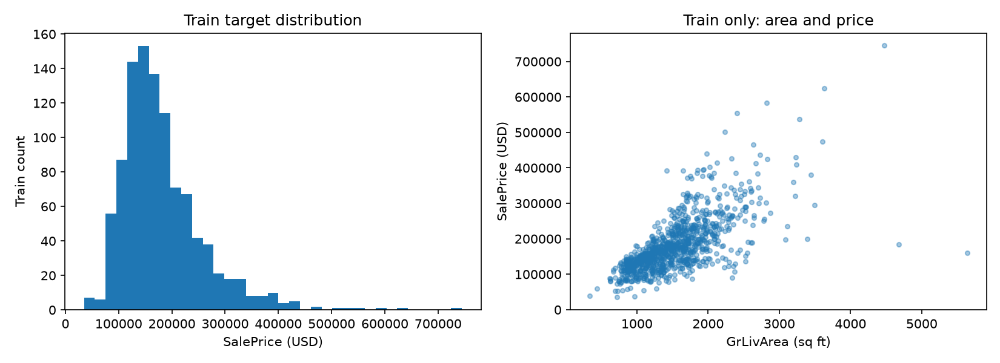

# Dataset audit

Status: PASS

Full-source quality checks only. Descriptive statistics/outliers/plots use TRAIN only; holdout excluded.

Rows: 1460; columns: 81; exact duplicates: 0; content duplicates: 0.
Invalid records: {}. Negative areas: {}. No rows removed.

| Column | Dtype | Missing |
|---|---|---:|
| Id | int64 | 0 |
| MSSubClass | int64 | 0 |
| MSZoning | object | 0 |
| LotFrontage | float64 | 259 |
| LotArea | int64 | 0 |
| Street | object | 0 |
| Alley | object | 1369 |
| LotShape | object | 0 |
| LandContour | object | 0 |
| Utilities | object | 0 |
| LotConfig | object | 0 |
| LandSlope | object | 0 |
| Neighborhood | object | 0 |
| Condition1 | object | 0 |
| Condition2 | object | 0 |
| BldgType | object | 0 |
| HouseStyle | object | 0 |
| OverallQual | int64 | 0 |
| OverallCond | int64 | 0 |
| YearBuilt | int64 | 0 |
| YearRemodAdd | int64 | 0 |
| RoofStyle | object | 0 |
| RoofMatl | object | 0 |
| Exterior1st | object | 0 |
| Exterior2nd | object | 0 |
| MasVnrType | object | 872 |
| MasVnrArea | float64 | 8 |
| ExterQual | object | 0 |
| ExterCond | object | 0 |
| Foundation | object | 0 |
| BsmtQual | object | 37 |
| BsmtCond | object | 37 |
| BsmtExposure | object | 38 |
| BsmtFinType1 | object | 37 |
| BsmtFinSF1 | int64 | 0 |
| BsmtFinType2 | object | 38 |
| BsmtFinSF2 | int64 | 0 |
| BsmtUnfSF | int64 | 0 |
| TotalBsmtSF | int64 | 0 |
| Heating | object | 0 |
| HeatingQC | object | 0 |
| CentralAir | object | 0 |
| Electrical | object | 1 |
| 1stFlrSF | int64 | 0 |
| 2ndFlrSF | int64 | 0 |
| LowQualFinSF | int64 | 0 |
| GrLivArea | int64 | 0 |
| BsmtFullBath | int64 | 0 |
| BsmtHalfBath | int64 | 0 |
| FullBath | int64 | 0 |
| HalfBath | int64 | 0 |
| BedroomAbvGr | int64 | 0 |
| KitchenAbvGr | int64 | 0 |
| KitchenQual | object | 0 |
| TotRmsAbvGrd | int64 | 0 |
| Functional | object | 0 |
| Fireplaces | int64 | 0 |
| FireplaceQu | object | 690 |
| GarageType | object | 81 |
| GarageYrBlt | float64 | 81 |
| GarageFinish | object | 81 |
| GarageCars | int64 | 0 |
| GarageArea | int64 | 0 |
| GarageQual | object | 81 |
| GarageCond | object | 81 |
| PavedDrive | object | 0 |
| WoodDeckSF | int64 | 0 |
| OpenPorchSF | int64 | 0 |
| EnclosedPorch | int64 | 0 |
| 3SsnPorch | int64 | 0 |
| ScreenPorch | int64 | 0 |
| PoolArea | int64 | 0 |
| PoolQC | object | 1453 |
| Fence | object | 1179 |
| MiscFeature | object | 1406 |
| MiscVal | int64 | 0 |
| MoSold | int64 | 0 |
| YrSold | int64 | 0 |
| SaleType | object | 0 |
| SaleCondition | object | 0 |
| SalePrice | int64 | 0 |

## TRAIN-only statistics

| Column | Min | Max | Mean | Median | Std |
|---|---:|---:|---:|---:|---:|
| Id | 1.0 | 1460.0 | 732.3385518591 | 735.5 | 425.8604021698 |
| MSSubClass | 20.0 | 190.0 | 57.0596868885 | 50.0 | 42.6697148253 |
| LotFrontage | 21.0 | 313.0 | 70.375 | 70.0 | 25.5336073105 |
| LotArea | 1300.0 | 215245.0 | 10745.4373776908 | 9600.0 | 11329.75342267 |
| OverallQual | 1.0 | 10.0 | 6.1281800391 | 6.0 | 1.3713910576 |
| OverallCond | 1.0 | 9.0 | 5.5645792564 | 5.0 | 1.1105573726 |
| YearBuilt | 1872.0 | 2010.0 | 1970.9951076321 | 1972.0 | 30.7488161074 |
| YearRemodAdd | 1950.0 | 2010.0 | 1984.7573385519 | 1994.0 | 20.7471088804 |
| MasVnrArea | 0.0 | 1378.0 | 105.2610402355 | 0.0 | 172.7077052057 |
| BsmtFinSF1 | 0.0 | 5644.0 | 446.1761252446 | 390.0 | 459.971174306 |
| BsmtFinSF2 | 0.0 | 1127.0 | 42.3688845401 | 0.0 | 151.2105314108 |
| BsmtUnfSF | 0.0 | 2336.0 | 571.2230919765 | 483.5 | 446.0045316449 |
| TotalBsmtSF | 0.0 | 6110.0 | 1059.7681017613 | 995.0 | 447.4234366626 |
| 1stFlrSF | 334.0 | 4692.0 | 1169.7377690802 | 1096.5 | 389.5505153858 |
| 2ndFlrSF | 0.0 | 2065.0 | 353.7387475538 | 0.0 | 441.1249634121 |
| LowQualFinSF | 0.0 | 572.0 | 5.7661448141 | 0.0 | 47.9495644737 |
| GrLivArea | 334.0 | 5642.0 | 1529.2426614481 | 1476.5 | 530.9718049107 |
| BsmtFullBath | 0.0 | 3.0 | 0.4227005871 | 0.0 | 0.5193544422 |
| BsmtHalfBath | 0.0 | 2.0 | 0.0596868885 | 0.0 | 0.2411186381 |
| FullBath | 0.0 | 3.0 | 1.5821917808 | 2.0 | 0.5444006583 |
| HalfBath | 0.0 | 2.0 | 0.3747553816 | 0.0 | 0.4943051682 |
| BedroomAbvGr | 0.0 | 8.0 | 2.8904109589 | 3.0 | 0.8111164646 |
| KitchenAbvGr | 0.0 | 2.0 | 1.0450097847 | 1.0 | 0.2120963641 |
| TotRmsAbvGrd | 2.0 | 14.0 | 6.5450097847 | 6.0 | 1.6302207027 |
| Fireplaces | 0.0 | 3.0 | 0.6135029354 | 1.0 | 0.6507237435 |
| GarageYrBlt | 1900.0 | 2010.0 | 1978.6766528926 | 1980.0 | 24.8146342459 |
| GarageCars | 0.0 | 4.0 | 1.7837573386 | 2.0 | 0.7307506048 |
| GarageArea | 0.0 | 1418.0 | 477.1203522505 | 484.0 | 208.4432955037 |
| WoodDeckSF | 0.0 | 857.0 | 97.5489236791 | 0.0 | 131.6918726351 |
| OpenPorchSF | 0.0 | 547.0 | 49.5254403131 | 27.0 | 69.2059683226 |
| EnclosedPorch | 0.0 | 552.0 | 21.3033268102 | 0.0 | 61.5343797481 |
| 3SsnPorch | 0.0 | 508.0 | 3.8816046967 | 0.0 | 32.5477224277 |
| ScreenPorch | 0.0 | 480.0 | 15.5655577299 | 0.0 | 56.4457485946 |
| PoolArea | 0.0 | 738.0 | 2.7436399217 | 0.0 | 39.6715312958 |
| MiscVal | 0.0 | 8300.0 | 41.5655577299 | 0.0 | 338.132358375 |
| MoSold | 1.0 | 12.0 | 6.3639921722 | 6.0 | 2.6501150183 |
| YrSold | 2006.0 | 2010.0 | 2007.8140900196 | 2008.0 | 1.3258069462 |
| SalePrice | 34900.0 | 745000.0 | 181312.6927592955 | 165000.0 | 77617.4610052064 |

Review flags only (GrLivArea >4000, LotArea >100000 sq ft; target 1.5 IQR). No deletion.

Area flags: [{'Id': 1183, 'GrLivArea': 4476, 'LotArea': 15623, 'SalePrice': 745000}, {'Id': 524, 'GrLivArea': 4676, 'LotArea': 40094, 'SalePrice': 184750}, {'Id': 707, 'GrLivArea': 1824, 'LotArea': 115149, 'SalePrice': 302000}, {'Id': 250, 'GrLivArea': 2144, 'LotArea': 159000, 'SalePrice': 277000}, {'Id': 1299, 'GrLivArea': 5642, 'LotArea': 63887, 'SalePrice': 160000}, {'Id': 336, 'GrLivArea': 1786, 'LotArea': 164660, 'SalePrice': 228950}, {'Id': 314, 'GrLivArea': 2036, 'LotArea': 215245, 'SalePrice': 375000}]

Target IQR flags (source IDs): [1183, 1143, 179, 679, 225, 322, 1354, 337, 350, 1389, 988, 645, 390, 441, 1170, 804, 1182, 186, 279, 689, 826, 12, 516, 474, 1269, 314, 321, 497, 1374, 878, 54, 152, 609, 113, 643, 379, 162, 703, 1268, 1438, 770]

Target summary: {'count': 1022.0, 'mean': 181312.6927592955, 'std': 77617.4610052064, 'min': 34900.0, '1%': 63415.0, '25%': 130000.0, '50%': 165000.0, '75%': 215000.0, '99%': 429159.9999999999, 'max': 745000.0}

